# Fleet Compliance Hub

[](https://github.com/LoganTaylorITGuy/fleet-compliance-hub/actions/workflows/ci.yml)


A multi-tenant compliance portal for trucking fleets. Driver qualification files,
hours of service, inspections, maintenance, drug and alcohol testing, and
training on one screen. A compliance provider manages many carrier clients, and
each carrier logs in to see only its own data.

<picture>
  <source media="(prefers-color-scheme: dark)" srcset="docs/screenshots/provider-dashboard-dark.png">
  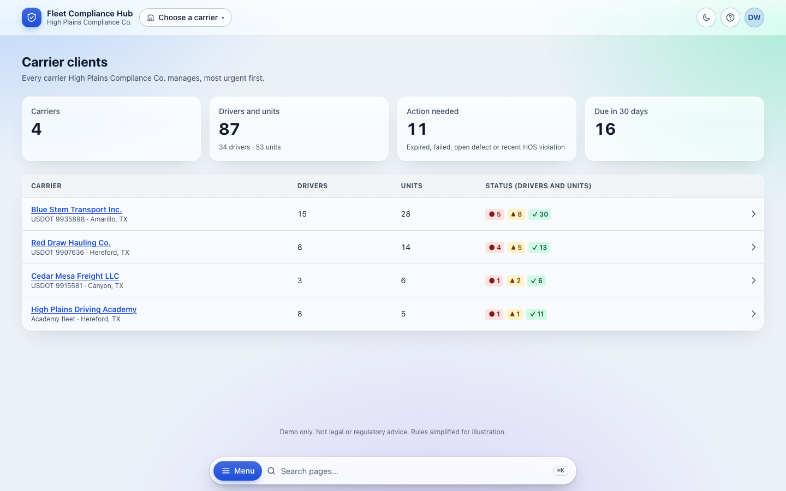
</picture>

> **Proof of concept with fictional data.** Every company, person, DOT/MC/CDL
> number and VIN is made up. Compliance rules are simplified for illustration
> and are not legal or regulatory advice.

## Why I built this

Small fleets track compliance in spreadsheets, paper folders and whatever their
ELD vendor shows them. The work is real and the deadlines are unforgiving: an
expired medical card, a missed annual inspection or an open DVIR defect can
put a truck or a driver out of service. Compliance providers who look after
dozens of these carriers spend their days chasing those dates across
everyone's spreadsheets.

I wanted to show what that looks like done properly, with one screen per carrier
and one screen across all of them, ranked by what needs attention first. I
care about four things equally: **security** (one carrier must never see
another's data), **function** (it has to work with the spreadsheets people
already have), **ease of use**, and **how it looks**. The person using it sees
the design before anything else, and a product people pay for shouldn't look
like it was assembled in an afternoon.

I come from IT infrastructure and security leadership, so the engineering
discipline is part of the point. Every feature landed through a pull request
with automated checks, and tenant isolation is enforced in one place and
tested on every change.

## Highlights

- **Provider and carrier dashboards:** every carrier ranked by urgency; per
  carrier, what needs action now and what's due in the next 30 days.
- **Red / yellow / green rules:** expired items, failed tests, open DVIR
  defects and recent HOS violations are red; anything due within 30 days is
  yellow. Thresholds live in one file, and every rule has unit tests.
- **Drivers, Fleet, Hours of Service and Training** pages with search,
  filters and detail views: the driver qualification file checklist, DVIRs
  linked to shop repairs, and academy student progress.
- **Spreadsheet import** for the messy files fleets really keep: column
  matching suggested from headers, saved templates, dates in any common format,
  fix-or-skip for bad rows, and **undo**. **Excel export** on every table.
- **Motive ELD stub:** a "Sync now" that shows where live ELD data would flow
  in, using clearly labeled mock data. No real endpoints are guessed.
- **Four roles:** Provider Admin, Provider Limited (for example, trailer shop or
  academy staff), Carrier Admin and Carrier Viewer, plus a full **audit log**.
- **Light and dark themes** with a frosted-glass look, a full-width layout, and
  an always-available search bar with recents and suggestions. Works at phone
  width.

## Screenshots

Each image follows your GitHub theme: light or dark.

| | |
|---|---|
| **Carrier dashboard:** needs action now, expiring in 30 days <picture><source media="(prefers-color-scheme: dark)" srcset="docs/screenshots/carrier-dashboard-dark.png">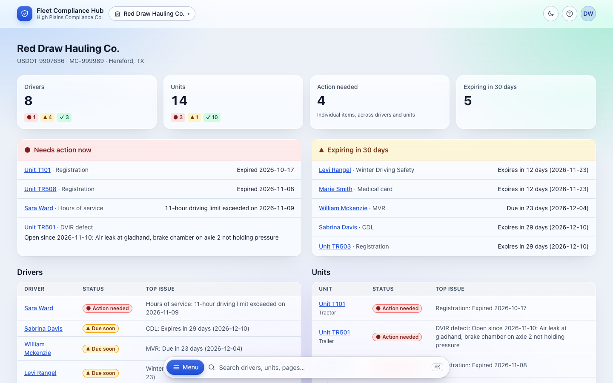</picture> | **Driver detail:** qualification file, tests, training, hours <picture><source media="(prefers-color-scheme: dark)" srcset="docs/screenshots/driver-detail-dark.png">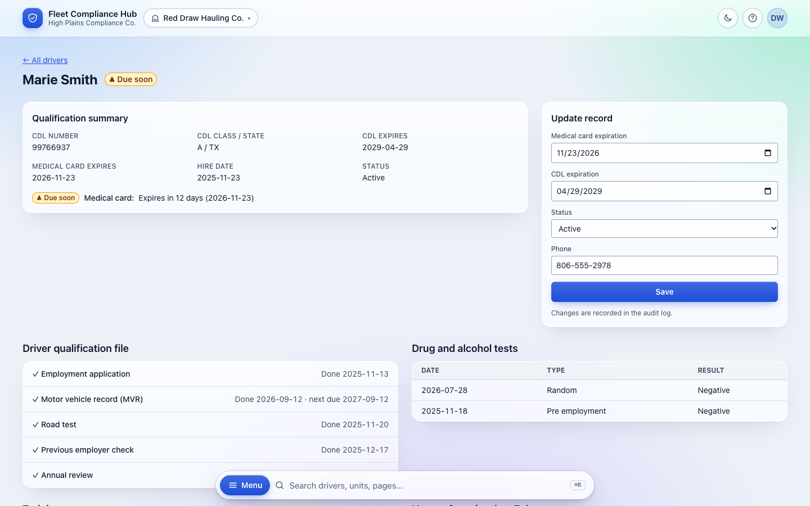</picture> |
| **Unit detail:** open DVIR defect in the trailer shop <picture><source media="(prefers-color-scheme: dark)" srcset="docs/screenshots/unit-detail-dark.png">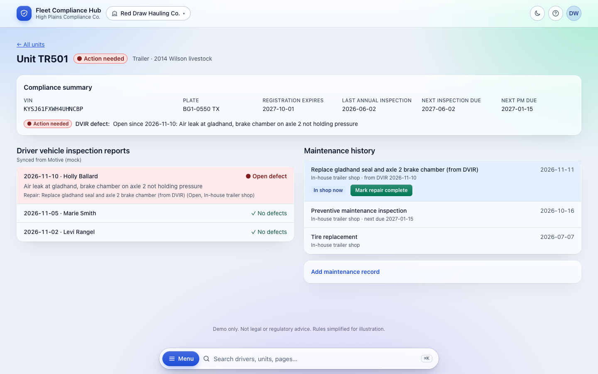</picture> | **Hours of Service:** 7 days, violation flagged <picture><source media="(prefers-color-scheme: dark)" srcset="docs/screenshots/hours-dark.png">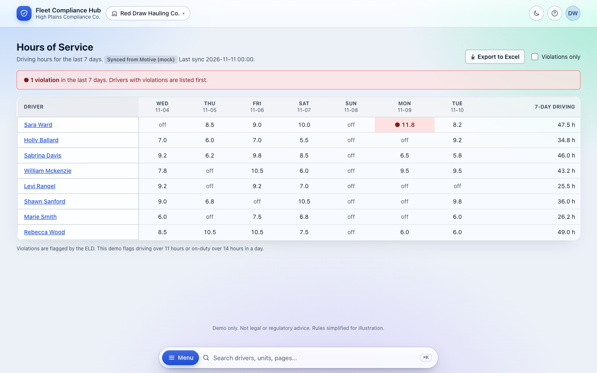</picture> |
| **Import review:** bad rows fixed or skipped before saving <picture><source media="(prefers-color-scheme: dark)" srcset="docs/screenshots/import-review-dark.png">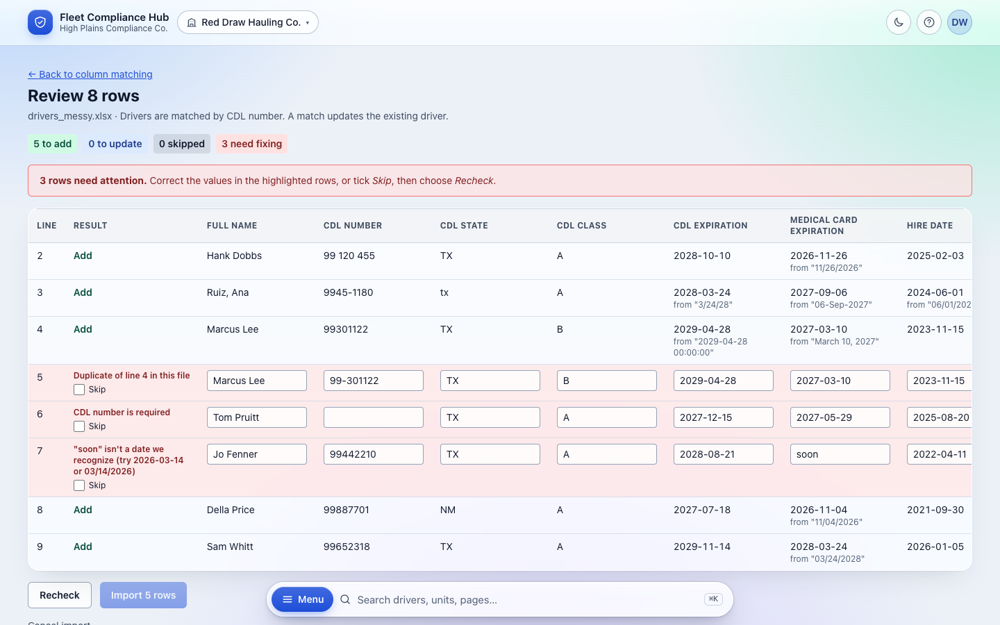</picture> | **Search:** drivers, units and pages as you type <picture><source media="(prefers-color-scheme: dark)" srcset="docs/screenshots/search-suggestions-dark.png">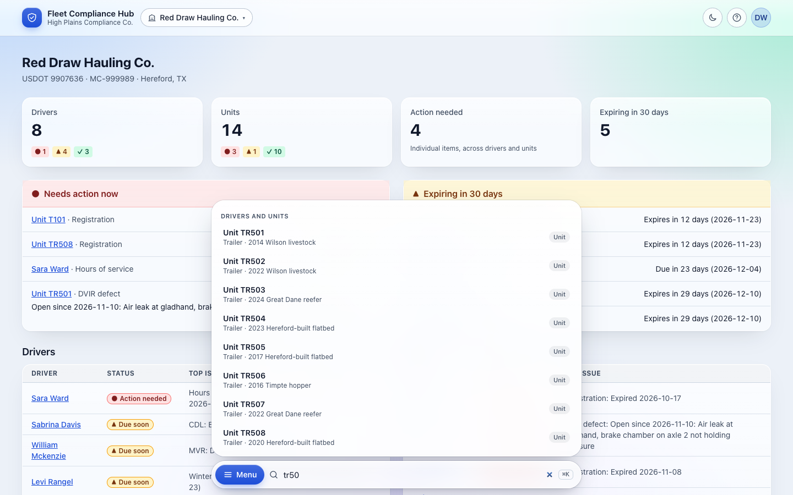</picture> |
| **Menu overlay** <picture><source media="(prefers-color-scheme: dark)" srcset="docs/screenshots/menu-dark.png">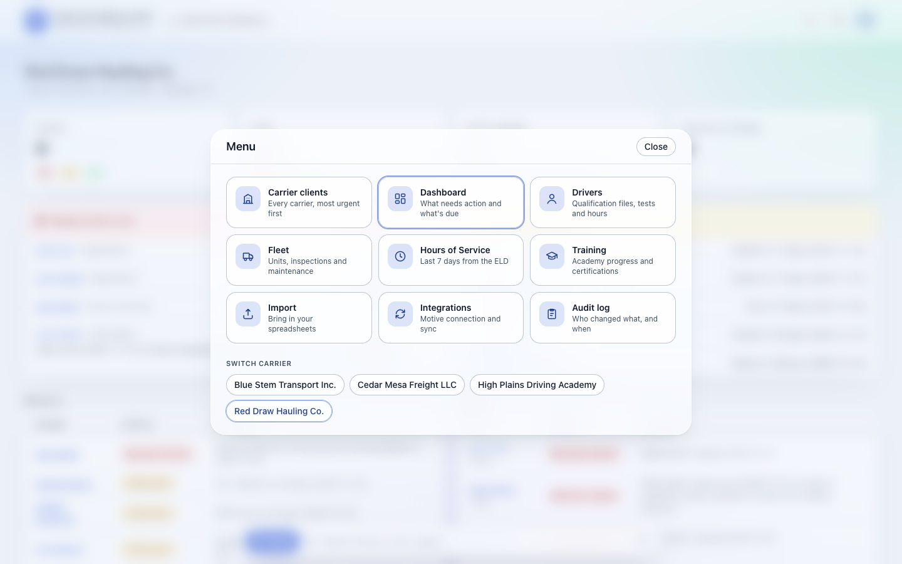</picture> | **Login with demo personas** <picture><source media="(prefers-color-scheme: dark)" srcset="docs/screenshots/login-dark.png">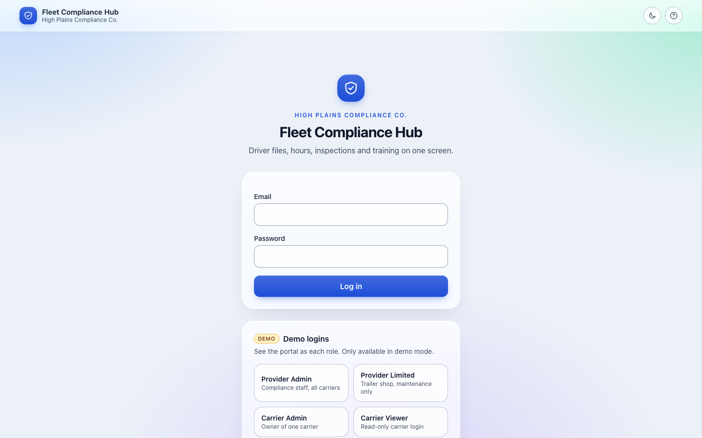</picture> |

<p align="center">
  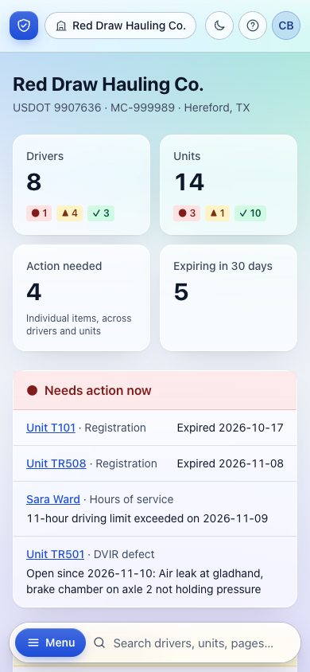
  &nbsp;
  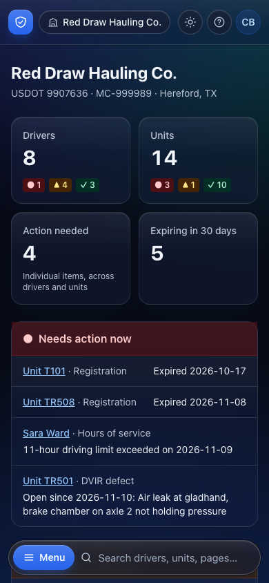
</p>

## Quick start

Requires Python 3.12+.

```bash
git clone https://github.com/LoganTaylorITGuy/fleet-compliance-hub.git
cd fleet-compliance-hub
python3.12 -m venv .venv && source .venv/bin/activate
pip install -e ".[dev]"
cp .env.example .env            # turns on demo mode and the one-click logins

flask db upgrade && python seed.py && flask run
```

Open <http://localhost:5000> (on macOS, if AirPlay holds port 5000, use
`flask run --port 5050`). Without a `.env`, the app still runs, but demo mode is
off and you log in with an email and password.

To reload fresh demo data (dates are relative to today): `python seed.py --reset`.

### Demo logins

With `DEMO_MODE=true`, the login page has one-click buttons for each role. To
type them instead, every account uses the password **`fleet-demo-2026`** (set
`SEED_PASSWORD` to change it).

| Role | Email | Sees |
|---|---|---|
| Provider Admin | `admin@demo.example` | Every carrier; switches between them |
| Provider Limited (trailer shop) | `shop@demo.example` | Fleet and maintenance only |
| Provider Limited (academy) | `academy@demo.example` | Training only |
| Carrier Admin | `owner@demo.example` | Red Draw Hauling Co., including imports and audit |
| Carrier Viewer | `viewer@demo.example` | Red Draw Hauling Co., read only |

These are demo credentials for fictional data. `DEMO_MODE` must never be on in
production, and the app refuses to start if it is.

### Share a live demo (HTTPS link and QR code)

For a demo on someone else's phone, without fighting guest Wi-Fi:

```bash
scripts/demo-tunnel.sh --reset
```

This serves the app with [waitress](https://docs.pylonsproject.org/projects/waitress/)
on `127.0.0.1` only, opens a free
[Cloudflare quick tunnel](https://developers.cloudflare.com/cloudflare-one/connections/connect-networks/do-more-with-tunnels/trycloudflare/)
(no account needed; requires `cloudflared`), and prints a public
`https://….trycloudflare.com` link plus a QR code (if `qrencode` is installed).
Secure cookies and proxy headers are turned on for that run only.

The link is public while the script runs, and demo mode's one-click logins are
on. The data is fictional, but run it only for the length of a demo. **Ctrl+C**
closes the tunnel. If the script is killed any other way, a watchdog closes the
tunnel within seconds, so the link never outlives the script.

### A 10-minute walkthrough

1. **Provider Admin:** carrier clients ranked by urgency.
2. Open **Red Draw Hauling Co.** and review *Needs action now*.
3. Open the driver whose **medical card expires in 12 days** to see the full file.
4. **Hours of Service:** a violation two days ago, synced from Motive (mock).
5. **Fleet → TR501:** an open DVIR defect with its repair in the in-house trailer
   shop. **Mark repair complete** resolves it.
6. Switch to **High Plains Driving Academy → Training**: student progress.
7. **Import → Drivers →** [`samples/drivers_messy.xlsx`](samples/): match
   columns, fix the bad date, skip the duplicate and the blank row, import, and
   watch the dashboard update. Then **undo**.
8. Log in as **Carrier Viewer:** one carrier only, read only.

## How it's built

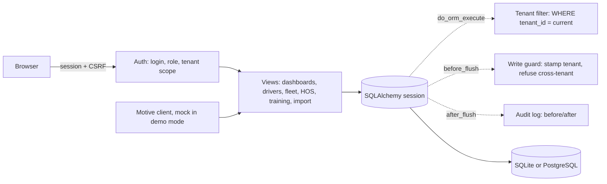

**Stack:** Python 3.12, Flask (app factory, blueprints), SQLAlchemy 2,
Flask-Migrate (Alembic), Flask-Login, Flask-WTF, pandas + openpyxl, Tailwind
CSS (compiled ahead of time, so there's no CDN at runtime), and a little vanilla
JavaScript. SQLite locally; PostgreSQL is tested in CI.

```text
app/
  tenancy.py        tenant isolation: one query filter + one write guard
  permissions.py    the role table: who can view or edit each area
  audit/            automatic audit log + the Audit log page
  compliance/       red/yellow/green rules (pure functions), thresholds, loader
  imports/          parsing, column matching, validation, commit and undo
  integrations/     Motive client (mock) and the sync job
  dashboard/ drivers/ fleet/ hos/ training/   feature pages
  templates/ static/                          UI, design tokens, theme
migrations/         Alembic
samples/            deliberately messy spreadsheets
tests/              302 tests
```

## Security and tenant isolation

- **One place, every query.** Every table that holds a carrier's data
  inherits `TenantScoped`. One SQLAlchemy `do_orm_execute` hook adds
  `tenant_id = <current carrier>` to every select, update and delete, including
  joins and lazy-loaded relationships. Views never filter by tenant themselves,
  so none can forget to.
- **Writes are guarded too.** A `before_flush` hook stamps new rows with the
  current tenant and refuses any write that would cross tenants, including
  linking a record to another carrier's driver or unit.
- **Fails closed.** With no tenant set, queries return nothing and writes raise.
- **No confirming existence.** Guessing another carrier's record ID in a URL
  returns **404, not 403**.
- **Tested like it matters.** 62 isolation tests run as their own CI check.
  Removing the query filter makes 36 of them fail; removing the write guard
  makes 8 fail.
- Also: hashed passwords, CSRF on every form, a strict Content Security Policy
  (no inline scripts), no open redirects, escaping for spreadsheet formula
  injection on Excel export, uploads staged server-side and bound to their
  tenant, and no secrets in the repo (configuration comes from environment
  variables).

## Engineering workflow

- **Protected `main`:** changes land by pull request only, and the rule
  applies to admins too. Each build step was its own PR; see the
  [closed pull requests](https://github.com/LoganTaylorITGuy/fleet-compliance-hub/pulls?q=is%3Apr+is%3Aclosed).
- **Six required checks on every PR:** `lint` (ruff), `test` (pytest with
  coverage, 97%), `tenant-isolation`, `migrations (sqlite)`,
  `migrations (postgresql)` (fresh database, upgrade, drift check, seed,
  downgrade), and `audit` (pip-audit).
- **Accessibility is tested, not assumed.** `tests/test_design_tokens.py`
  checks WCAG AA contrast for every text color in both themes, composited over
  the translucent glass. Status never relies on color alone, and every page is
  checked at phone width.
- **Docs:** [CHANGELOG](CHANGELOG.md), [CONTRIBUTING](CONTRIBUTING.md) and a
  pull request template with a testing checklist.

## What this would look like for real

This POC shows the shape of the product. A production build would add:

- **Live Motive data:** endpoints confirmed against Motive's developer
  documentation, per-carrier API keys in a secrets manager, and background sync
  jobs with retries and rate limiting.
- **Document uploads:** scanned medical cards, MVRs and road tests attached to
  the driver file, with malware scanning and retention rules.
- **Email and text alerts:** "medical card expires in 30 days" sent to the
  right person before it turns red.
- **Audit-ready reports:** a driver qualification file packet or fleet
  inspection summary as PDF, ready for a DOT audit.
- **Rules reviewed by a compliance professional** against current FMCSA
  regulations, plus Clearinghouse queries.
- **SSO and MFA**, user management screens, and per-carrier settings.
- **Hosting:** staging and production environments, deploys from tagged
  releases, managed PostgreSQL with backups, monitoring and alerting.

## License

[MIT](LICENSE) © 2026 Logan D Taylor
