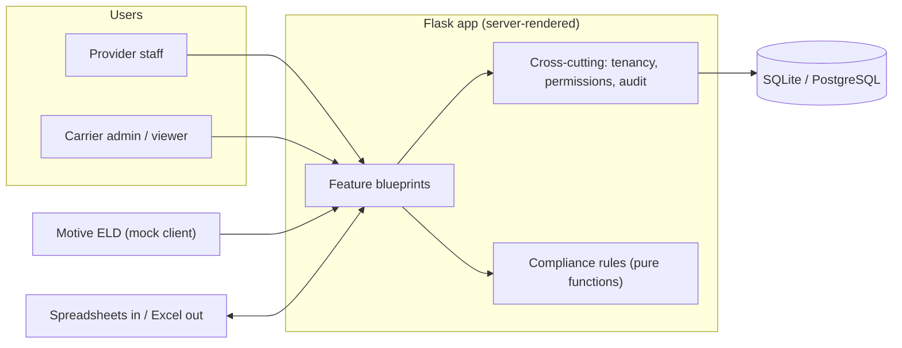
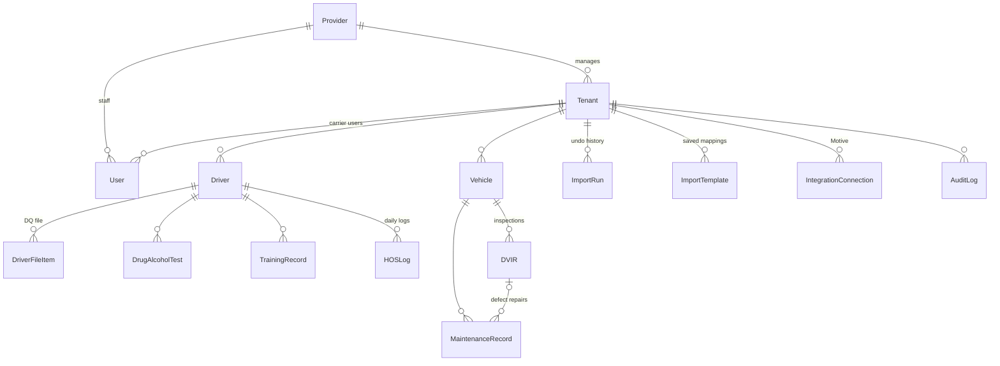
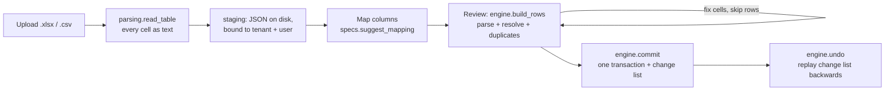

# Architecture

How Fleet Compliance Hub is put together, why it is built that way, and where
to make a change. Decisions are recorded one per file in [docs/adr/](adr/).

- [1. The shape of the system](#1-the-shape-of-the-system)
- [2. One request, start to finish](#2-one-request-start-to-finish)
- [3. Rules that live in exactly one place](#3-rules-that-live-in-exactly-one-place)
- [4. Where things live](#4-where-things-live)
- [5. Data model](#5-data-model)
- [6. Feature flows](#6-feature-flows)
- [7. Front end](#7-front-end)
- [8. Testing and CI](#8-testing-and-ci)
- [9. How to add...](#9-how-to-add)
- [10. Known limitations](#10-known-limitations)

## 1. The shape of the system

A compliance provider manages many carrier clients (and a driving academy).
Each carrier is a **tenant**. Provider staff can work in any of their own
carriers; carrier users only ever see their own.



It is a **server-rendered Flask monolith**: Jinja templates, a small amount
of progressive-enhancement JavaScript, and SQLAlchemy over SQLite (local) or
PostgreSQL (tested in CI). See [ADR 0005](adr/0005-server-rendered-flask-monolith.md)
for why it isn't a single-page app.

## 2. One request, start to finish

Every request passes through the same steps. Views only contain the logic
for their own page; everything below them happens automatically.

```mermaid
sequenceDiagram
  autonumber
  participant B as Browser
  participant A as auth.before_app_request
  participant V as View (+ require_view / require_edit)
  participant S as SQLAlchemy session
  participant T as tenancy hooks
  participant L as audit hook
  participant DB as Database

  B->>A: GET /drivers/42
  A->>A: login required? resolve_scope(user)
  A->>T: set_request_scope(tenant 7)
  A->>V: continue
  V->>V: can_view(user, "drivers") else 403
  V->>S: select(Driver).where(id == 42)
  S->>T: do_orm_execute
  T->>DB: ... AND drivers.tenant_id = 7
  DB-->>V: no row (belongs to tenant 9)
  V-->>B: 404, not 403 (existence never confirmed)
  Note over S,L: On a write instead:<br/>before_flush stamps tenant_id and refuses cross-tenant rows,<br/>after_flush writes AuditLog rows in the same transaction
  Note over A: teardown clears the scope; after_request adds CSP and security headers
```

| Step | Code | What it guarantees |
|---|---|---|
| Login and scope | [`auth/routes.py`](../app/auth/routes.py) `require_login_and_set_scope`, [`auth/services.py`](../app/auth/services.py) `resolve_scope` | Carrier users are pinned to their tenant. Provider users get the carrier they picked, and only if it belongs to their provider. Anyone else gets **no access**. |
| Area permission | [`permissions.py`](../app/permissions.py) `require_view` / `require_edit` | One role table decides which areas a role may view or edit. Templates read the same table. |
| Tenant filter | [`tenancy.py`](../app/tenancy.py) `_filter_queries_by_tenant` | Adds `tenant_id = current` to every ORM select, update and delete, including joins and lazy loads. |
| Write guard | [`tenancy.py`](../app/tenancy.py) `_guard_writes` | Stamps new rows, refuses moving a row or linking it to another tenant's parent. |
| Audit | [`audit/__init__.py`](../app/audit/__init__.py) `_write_audit_rows` | Before/after values for every insert, update and delete of tenant data. |
| Headers | [`app/__init__.py`](../app/__init__.py) `_register_security_headers` | Strict CSP (`script-src 'self'`, no inline scripts), `nosniff`, `DENY` framing. |

## 3. Rules that live in exactly one place

The design goal is that each important rule has **one home**, so it can't be
forgotten in one view or applied two different ways.

| Concern | The one place | Decision |
|---|---|---|
| Which carrier's rows you see | `app/tenancy.py` | [ADR 0001](adr/0001-tenant-isolation-in-the-orm.md), [0002](adr/0002-fail-closed-and-404.md) |
| Which areas a role can use | `app/permissions.py` | [ADR 0001](adr/0001-tenant-isolation-in-the-orm.md) |
| What gets audited | `app/audit/__init__.py` | [ADR 0003](adr/0003-automatic-audit-log.md) |
| Red / yellow / green | `app/compliance/rules.py` + `thresholds.py` | [ADR 0004](adr/0004-pure-compliance-rules.md) |
| What "today" means | `app/clock.py` (US Central) | [ADR 0004](adr/0004-pure-compliance-rules.md) |
| How CDL / unit / VIN values match | `app/identifiers.py` | Shared by import and Motive sync |
| Colors and themes | `app/static/css/input.css` design tokens | [ADR 0006](adr/0006-precompiled-tailwind-and-design-tokens.md) |
| Configuration and secrets | `app/config.py` (environment only) | No secrets in the repo |

Views deliberately **do not** filter by tenant, check roles by hand, or write
audit rows. If you find yourself doing one of those in a view, the change
belongs in the module above instead.

## 4. Where things live

```text
app/
  __init__.py         app factory: config, extensions, blueprints, headers
  config.py           environment-driven settings (Config, TestConfig)
  extensions.py       db, migrate, login_manager, csrf instances
  models.py           every table; tenant data inherits TenantScoped

  # Cross-cutting (used by every feature, owned by none)
  tenancy.py          tenant isolation: query filter + write guard
  permissions.py      role table: can_view / can_edit / decorators
  audit/              automatic audit hook + the Audit log page
  identifiers.py      normalize CDL / unit / VIN for matching
  clock.py            today() in US Central time
  formatting.py       Jinja filters (dates, labels)
  views.py            small view helpers (tenant_required, link_for)
  listing.py          shared list-page filters (status level, search term)
  navigation.py       Menu overlay items, filtered by role
  search.py           quick search behind the bottom bar

  # Domain logic (no Flask, no request)
  compliance/
    rules.py          pure red/yellow/green functions, unit tested
    thresholds.py     the numbers (30-day warning, 7-day HOS window...)
    service.py        loads rows efficiently, applies the rules

  # Feature blueprints (one folder per area of the app)
  auth/  main/  dashboard/  drivers/  fleet/  hos/  training/
  imports/
    parsing.py        read .xlsx/.csv, parse messy dates/numbers/booleans
    specs.py          what each import type expects (fields, synonyms)
    resolvers.py      match rows to existing records in this tenant
    engine.py         build rows -> resolve -> commit -> undo
    staging.py        uploads parked on disk between wizard steps
    routes.py         the wizard pages
  integrations/
    motive.py         Motive client (mock in demo mode; real calls stubbed)
    sync.py           incremental sync into this tenant
    routes.py         Integrations page and Sync now
  exports.py          Excel downloads with formula-injection escaping

  # Demo data
  seed/
    plans.py          the shape of the data set (tenants, sizes, courses)
    generator.py      seeded random bulk data (repeatable)
    scenario.py       hand-placed records the walkthrough needs + demo logins

  templates/          Jinja: base.html, partials/ (header, dock, overlays), one folder per feature
  static/             compiled CSS, design tokens, vanilla JS (theme, overlays, search)
migrations/           Alembic, checked for drift in CI
scripts/demo-tunnel.sh  live HTTPS demo via a Cloudflare quick tunnel
seed.py               CLI wrapper around app.seed
tests/                one file per area; isolation tests marked `isolation`
```

**Dependency direction.** Feature blueprints depend on the cross-cutting
modules and on `compliance/`; never the other way round, and features don't
import each other. `compliance/rules.py` imports nothing from Flask or the
database, which is why it can be tested with plain objects. Both rules are
enforced by `tests/test_architecture.py`.

## 5. Data model



`Provider`, `Tenant` and `User` are the only tables without a `tenant_id`.
Every other table inherits `TenantScoped`, and
`tests/test_tenant_isolation.py::test_every_scoped_model_is_registered` fails
if a new one is added without isolation tests.

## 6. Feature flows

### Spreadsheet import



Nothing is guessed before the user maps columns ("007" stays "007"), errors are
shown per cell so they can be fixed in place, blank cells never erase existing
data on update, and the whole import writes **one** audit summary rather than
one entry per row. See [ADR 0007](adr/0007-staged-import-with-undo.md).

### Motive sync

`integrations/sync.py` pulls hours of service from the day after the newest
synced log through today, DVIRs for the last two days, and current odometers.
Past days are never rewritten. In demo mode `MotiveClient` returns generated
data; real endpoints are deliberately left as marked TODOs until checked
against Motive's documentation. See [ADR 0008](adr/0008-motive-behind-a-client-boundary.md).

### Compliance status

`compliance/service.evaluate()` loads drivers and vehicles with their related
records in a fixed number of queries (`selectinload`), then calls the pure
rules. It has no tenant filter of its own: it returns whatever the active
scope allows, so the same function powers the carrier dashboard (one tenant)
and the provider dashboard (inside `all_tenants()`, matched back to that
provider's carriers).

## 7. Front end

- **Server-rendered first.** Every link and form works without JavaScript.
  `static/js/app.js` adds overlays, search-as-you-type, the theme switcher and
  keyboard shortcuts; `theme.js` applies the saved theme before first paint.
- **Layout:** full-width header (help, account and preferences) and a
  pill-shaped bottom dock with Menu (navigation overlay) and an always-available
  search bar (recents when empty, suggestions while typing). Partials live in
  `templates/partials/`.
- **Design tokens:** colors are semantic tokens (`text-ink`, `bg-danger-soft`,
  `glass`) with light and dark values, never raw palette classes.
  `tests/test_design_tokens.py` checks WCAG AA contrast for every pair in both
  themes, composited over the translucent glass.
- **Accessibility:** WCAG 2.1 AA; status is never shown by color alone; tables
  use `<th scope>`; every form control has a label; a skip link on every page.

## 8. Testing and CI

| Area | Tests |
|---|---|
| Tenant isolation (own CI job) | `test_tenant_isolation.py`, plus `isolation`-marked tests in imports, exports, Motive and search |
| Compliance rules | `test_compliance_rules.py` (pure, every rule), `test_compliance_service.py` (against seeded data) |
| Auth and permissions | `test_auth.py` (including the full role matrix) |
| Features | `test_dashboards.py`, `test_feature_pages.py`, `test_imports.py`, `test_exports.py`, `test_motive.py`, `test_search_and_shell.py` |
| Audit | `test_audit.py` |
| UI quality | `test_design_tokens.py` (contrast), `test_templates_lint.py` |
| Demo data | `test_seed.py` (planted records, determinism) |

CI runs six required checks on every pull request: `lint` (ruff, including
module docstrings and a complexity limit), `test` (pytest with coverage),
`tenant-isolation`, `migrations (sqlite)` and `migrations (postgresql)` (fresh
database, upgrade, model drift check, seed, downgrade, upgrade), and `audit`
(pip-audit).

## 9. How to add...

**A table that holds carrier data.** Inherit `TenantScoped`, add an Alembic
migration (`flask db migrate`), and add the model to the isolation test
parameters. Don't add tenant filters to views; the hooks already apply.

**A page.** Add a route to the feature's blueprint with `@require_view(area)`
(or `@require_edit` for actions), a template that extends `base.html`, and a
`NavItem` in `navigation.py` if it belongs in the Menu. Check it at 375 px in
both themes.

**A compliance rule.** Add a pure function in `compliance/rules.py`, put any
number in `thresholds.py`, call it from `driver_status` or `vehicle_status`,
and unit test it with plain objects. Make sure `service.py` eager-loads any new
relationship it reads.

**An import type.** Three entries, enforced by
`test_every_import_type_is_fully_registered`: an `ImportSpec` in `specs.py`, a
`Resolver` in `resolvers.py`, and a `WRITE_FIELDS` entry in `engine.py`.

## 10. Known limitations

This is a proof of concept. These are known and deliberate for now:

- **Provider dashboard reads broadly, then narrows.** It evaluates inside
  `all_tenants()` and keeps only the provider's own carriers. Correct with one
  provider per deployment, but a multi-provider deployment should add a
  provider-level scope so the query itself never reaches another provider's
  rows.
- **Motive endpoints are unverified.** The client shape is real; paths and
  fields are placeholders until checked against Motive's docs.
- **Staged uploads live on local disk.** Fine for one server; multiple servers
  would need shared storage (object storage) for `instance/uploads`.
- **No background worker.** Sync runs on request ("Sync now"). Production
  would schedule it.
- **Hosting is out of scope.** The demo runs through a temporary tunnel
  ([ADR 0009](adr/0009-demo-hosting-via-quick-tunnel.md)); a real deployment
  is sketched in the README under "What this would look like for real".
